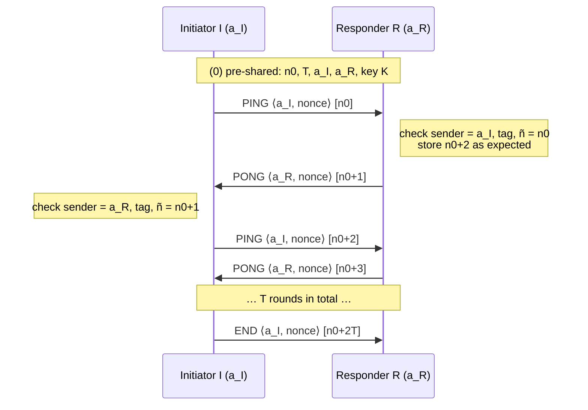
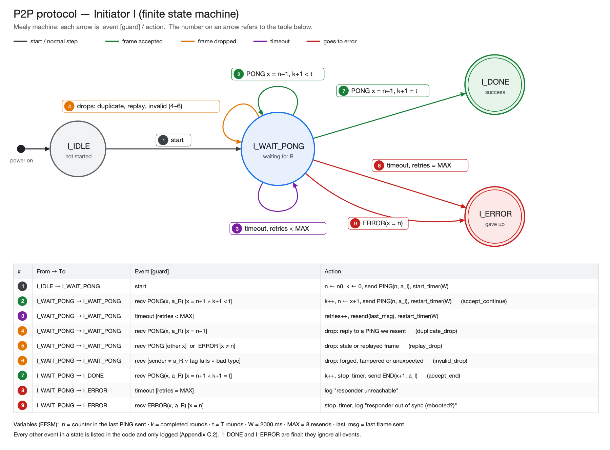
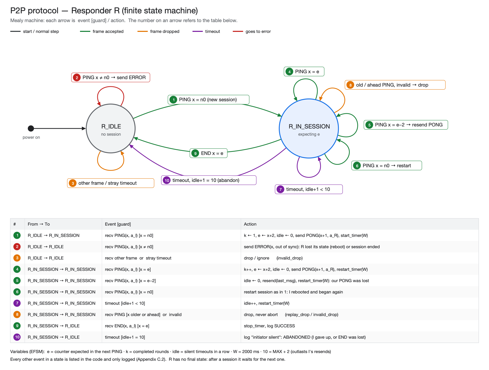

# Session 6 — Peer-to-peer MAC Frames Protocol (P2P)

| File | Task |
|---|---|
| `p2p_config.h` | Pre-shared constants (MACs, n0, T, key), timing, AEAD switch, fault injection |
| `p2p_unidirectional.c` | Task 1: I sends a frame every 2 s, R cycles the LED on receive |
| `p2p_fsm.h` / `p2p_fsm.c` | Tasks 2–7: the two state machines. Platform independent, so the same file runs on the boards and in the simulator |
| `p2p_protocol.c` | ESP32 side: radio frames, timer, LED, logging, `app_main` |
| `diagrams/fsm_initiator.png`, `diagrams/fsm_responder.png` | The two state diagrams (checkpoint 2) |
| `../../../Prosim/p2p/` | Laptop simulator running the same `p2p_fsm.c` (Appendix C, learning goal 4) |

## Getting started

1. In `main/CMakeLists.txt`, set `LAB_APP` to `"session6/p2p_unidirectional.c"` (task 1) or `"session6/p2p_protocol.c" "session6/p2p_fsm.c"` (the protocol).
2. Find the two boards' MAC addresses (see below) and put them into `P2P_INITIATOR_MAC` / `P2P_RESPONDER_MAC` in `p2p_config.h`.
3. Build and flash the **same** firmware to both boards. The role is chosen by MAC.
4. Start the monitor on both boards (two laptops is easiest). Either order works, because I resends until R answers.

> Note: the lab text says in step (2) that R "sends it addressed to R". That is a typo. R replies to **I**.

### Finding the MAC address of each board

Do this for each board, one at a time:

- **Read it with esptool, without flashing anything.** Plug in one board, open the ESP-IDF terminal (VS Code: *ESP-IDF: Open ESP-IDF Terminal*) and run:
  ```sh
  ls /dev/cu.usbmodem*                                   # find the port, e.g. /dev/cu.usbmodem101
  python -m esptool --port /dev/cu.usbmodem101 read-mac
  ```
  It prints `MAC: xx:xx:xx:xx:xx:xx`. On the ESP32-C6 the Wi-Fi station MAC used by the lab library is this base MAC.
- **From the flash log.** Every *Flash* prints the same `MAC: …` line near the top.
- **From our firmware.** At boot, `p2p_protocol.c` and `p2p_unidirectional.c` print `This board's MAC is …`. If the MAC is not in `p2p_config.h`, they also print `MAC not listed in p2p_config.h`.

Put a sticker on each board (D1 = initiator, D2 = responder) so you don't mix them up.

---

## Checkpoint 1: message sequence diagram of the ideal path



`⟨…⟩` is authenticated but readable (associated data). `[…]` is encrypted. Both are covered by the 16-byte Ascon tag.

**Frame payload** (after the 24-byte 802.11 header and the 8-byte LLC/SNAP header `AA AA 03 69 69 69 69 69`):

| Offset | Size | Field | AEAD mode |
|---|---|---|---|
| 0 | 1 | magic `0x6A` | associated data |
| 1 | 1 | type: 1 PING, 2 PONG, 3 END, 4 ERROR | associated data |
| 2 | 6 | sender identity (MAC) | associated data |
| 8 | 16 | nonce (random per frame; zeros in plaintext mode) | associated data |
| 24 | 4 | counter n, big-endian (network byte order) | encrypted |
| 28 | 1 | error code (0 = none, 1 = out of sync) | encrypted |
| 29 | 16 | Ascon tag | AEAD only |

---

## Checkpoint 2: FSMs and the failures they handle

The design follows Appendix C (revised manual, 24 Sept 2026):

- **Mealy machine (transition-assigned action):** every arrow is `event [guard] / action`. The work happens on the transition, never inside a state.
- **Extended FSM (EFSM):** counters and retries live in variables (the `p2p_party_t` struct) instead of extra states:

| Variable (Appendix C name) | In the code | Meaning |
|---|---|---|
| current state | `p->i_state`, `p->r_state` | which node of the graph we are in |
| n (I), e (R) | `p->n` | I: counter in the last PING sent. R: counter expected in the next PING |
| k | `p->rounds` | completed exchanges |
| t | `P2P_T` | rounds to run |
| W | `P2P_TIMEOUT_MS` (2000 ms) | waiting period of the timer |
| retries / idle | `p->retries` | I: resends of the current PING. R: consecutive silent timeouts |
| last_msg | `p->last_tx` | last frame sent, kept so a resend is identical |

- **Guards (Figure 7 style):** a received frame is first classified (identity, integrity, type, counter), then exactly one guarded branch fires. In C that is an `if / else if` chain inside `case EV_FRAME:`, as in Listing 2. Figure 6 does the same with a transient HANDLE_FRAME state. The log messages use its category names: `accept_continue`, `accept_end`, `duplicate_drop`, `replay_drop`, `invalid_drop`.

### Initiator



### Responder



In the code (`p2p_fsm.c`) the outer `switch` is on the state and the inner `switch` is on the event (`EV_START`, `EV_FRAME`, `EV_TIMEOUT`), as in Appendix C, Listing 1. **Every event is listed in every state.** Events that should not happen in a state (for example START while running, or a stray timeout) get a log message, so none are forgotten (C.2).

### Deviations from the ideal path

| Event | Detected by | Handling |
|---|---|---|
| R not powered or not ready | I timeout | I resends every 2 s, up to 8 times, then goes to `I_ERROR` "responder unreachable" |
| PING lost | I timeout | I resends the **identical** frame |
| PONG lost | I timeout; R sees `e−2` | R resends its last PONG. It does not count the round twice |
| Duplicate PONG (reply to a resent PING) | counter `n−1` | Ignored (`duplicate_drop`) |
| Frame from another device, ACKs, beacons | frame type, SNAP OUI, magic | Silently ignored |
| Wrong sender identity (spoofed or other board) | `addr2` and the sender field must both equal the peer | `invalid_drop` |
| Tampered or forged frame (AEAD on) | tag verification | `invalid_drop`. The sender's timeout causes a resend |
| Old frame replayed within the session | counter is older than expected | `replay_drop`. R **never aborts** on a stray PING, so a replay cannot kill the session |
| I reboots or its battery dies mid-session | R receives PING(n0) | R restarts the session |
| I silent for good | R timeout | R abandons the session after (`P2P_MAX_RETRIES` + 2) × W = 20 s. That is longer than I keeps retrying (18 s), so R never gives up first |
| R reboots mid-session | idle R receives PING(n ≠ n0) | R sends ERROR(out of sync), and I goes to `I_ERROR` immediately instead of waiting for timeouts |
| Old ERROR replayed | ERROR echoes the counter it refers to | I accepts ERROR only for its current `n` |
| END lost | R timeout | R abandons after 20 s and logs it. I has already finished. This is the Two Generals problem: whoever sends the last message never knows whether it arrived |
| Unexpected message type | guard chain | `invalid_drop` |

A resent frame is byte-for-byte identical, so under AEAD the same nonce is reused with the **same** plaintext. That produces an identical ciphertext and leaks nothing new. Each new message gets a fresh random nonce.

### No deadlock, no livelock (C.3.1)

- **Deadlock** (both sides waiting for each other forever) cannot happen. Every waiting state has a timer: I resends and finally gives up, and R abandons a silent session.
- **Livelock** (looping without progress) is bounded. I resends at most `P2P_MAX_RETRIES` times, and a duplicate never advances the counters.
- **Checked in the simulator:** 50,000+ random runs with loss, duplicates, bit errors and replays. No run ended in deadlock, livelock or an inconsistent state (see below).

### Why MAC-layer ARQ is not enough (C.3.2)

The 802.11 hardware already ACKs unicast frames and retransmits when no ACK arrives. The protocol still needs its own timeouts, resends and duplicate handling:

1. **Retry limit reached.** After the MAC retries (about 6 for short frames), the frame is simply gone, and nothing tells our program. Only our protocol timeout notices.
2. **Lost ACK.** The data frame arrived but its ACK was lost, so the MAC sends it again. The receiver can get the same frame twice, which is why R treats `x = e−2` as a duplicate and does not count it twice.
3. **The peer is dead** (battery, out of range). No MAC mechanism resolves this, but our timeout plus `I_ERROR` or abandoning the session does.
4. **An attacker can send a fake ACK** while jamming or blocking the real frame. The sender's MAC believes the frame was delivered, and only the protocol-level reply proves that it was.
5. **ARQ gives reliability, not security.** The checksum (FCS) is not keyed, so anyone can compute a valid FCS for a forged or replayed frame. Integrity against an attacker comes from the Ascon tag and the counter checks.

In Wireshark, look at the *Retry* bit in the Frame Control field to see MAC retransmissions.

### Tested in the simulator before flashing

`Prosim/p2p` runs the same `p2p_fsm.c` on the laptop over a simulated channel with loss, duplicates, bit errors, an attacker replaying recorded frames, R switched on late, and R rebooting. It found and fixed three problems:

1. R gave up (after 10 s) while I was still resending (until 18 s), so the session died with an ERROR. R's patience is now 20 s.
2. A duplicate PING did not reset R's silence counter.
3. A replayed old PING made R abort the session, a cheap denial-of-service attack. R now drops it.

See `Prosim/p2p/README.md` for the commands and the numbers.

---

## Checkpoint 3: code walk-through

**`p2p_fsm.c`** holds the protocol and is shared by the ESP32 and the simulator:
- `p2p_encode` / `p2p_decode` build and verify the payload above: magic, sender identity, then `ascon_aead_encrypt` / `ascon_aead_decrypt`.
- `radio_send` sends a frame, with the optional simulated loss and corruption for checkpoint 4. `resend_last` repeats the identical frame.
- `initiator_fsm` / `responder_fsm` are the two state machines: outer switch on the state, inner switch on the event, then the guard chain for frames.
- `p2p_handle_event` is the single entry point: it decodes a frame, then calls the right FSM for the party's role.
- The state machines reach the outside world only through seven `plat_*` functions: send, timer start/stop, LED, random bytes, clock, delay and log.

**`p2p_protocol.c`** is the ESP32 side:
- The `plat_*` functions map to the lab library and ESP-IDF:
  - send → `transmit()`
  - timer → `start_timeout_timer()` / `xTimerStop()`
  - LED → `cycle_light()`
  - random → `esp_fill_random()` (hardware TRNG)
  - clock → `esp_timer_get_time()`
- `fsm_event_dispatcher` is a FreeRTOS task that takes events from `fsm_event_queue` (filled by the library's radio callback and timeout timer). It checks that a frame is an 802.11 data frame with our SNAP header (the radio also delivers 14-byte ACKs), passes it to `p2p_handle_event`, and frees the frame.
- Events use the library's own `event_t` layout (`uint8_t event`: 0 = timeout, 1 = frame), so queue items always match what the library writes.
- `app_main` calls `setup()`, picks the role from the MAC, and on the initiator queues the START event.

---

## Checkpoint 4: run while inflicting bad events

> *"Run and monitor the P2P implementation, while inflicting the bad events that it can handle."*

We deliberately break things while the protocol runs and show that it copes. Tests 1–4c below were all run on the two boards, and the log excerpts are the real output. For each test: what we change, what happened, and what it proves, with the matching arrow in the FSM diagrams (`I-n` = initiator arrow n, `R-n` = responder arrow n).

### How to run a test (one laptop, two boards)

Our setup: both boards on one laptop. The port name depends on the USB socket, not the board:

| Port | Board MAC | Role |
|---|---|---|
| `/dev/cu.usbmodem101` | `48:f6:ee:c7:20:f0` | Responder (R) |
| `/dev/cu.usbmodem1101` | `48:f6:ee:c7:1f:18` | Initiator (I) |

If the cables are swapped, the names swap too. The monitor's boot lines (`This board's MAC is …`, `Role: …`) always tell you which board is which.

Routine for every test:
1. Close both monitors (`Ctrl+]`).
2. Change `p2p_config.h` (the setting each test names).
3. Build once, then flash **both** boards: R (`usbmodem101`) and I (`usbmodem1101`). Both must run the same build.
4. Open **R's monitor first**, from an ESP-IDF terminal: `idf.py -p /dev/cu.usbmodem101 monitor`.
5. Then open **I's monitor** (extension *Monitor* button, port `usbmodem1101`). I starts the run as soon as it boots.
6. To start another run: `Ctrl+T` then `Ctrl+R` in I's monitor, or press RST on the I board.
7. Afterwards, set the setting back before the next test.

**Why R first:** opening a monitor resets that board. I starts the protocol the moment it boots, while R just waits. If I's monitor is opened first, the run happens before R's monitor is open, or R gets reset in the middle of the run, which is exactly Test 4a below. The rule is simply: start the run only after both monitors are open.

Notes on reading the logs:
- R's timestamps are usually ahead of I's, because R booted earlier.
- After pressing RST, a monitor shows `--- Waiting for the device to reconnect` while the USB connection comes back, so the first second of output may be missing.
- `0 rounds/s` in a summary is only whole-number rounding (e.g. 5 rounds in 12 s). The time itself is correct.

### Overview

| Test | What we break | What it shows | Result |
|---|---|---|---|
| 1 | every 3rd frame is lost | timeout, resend, duplicate handling | ✅ SUCCESS 5/5 on both |
| 2 | one bit flipped in a frame, AEAD on | the Ascon tag rejects any change | ✅ SUCCESS 5/5, `auth=1` |
| 3 | the same bit flip, AEAD off | only the counter check catches it (weaker) | ✅ SUCCESS 5/5, `counter=1` |
| 4a | R reboots mid-run | ERROR message, I stops immediately | ✅ I: FAILED (responder reported error), the correct outcome |
| 4b | I reboots mid-run | R restarts the session from n0 | ✅ SUCCESS 50/50 on both |
| 4c | R unplugged mid-run | bounded retries, no deadlock | ✅ I: FAILED (timeout) after 8 resends, the correct outcome |
| 4d (optional) | R switched on late | I resends until R answers | not run yet |
| 5 (optional) | wrong key on one board | a stranger without the key gets nothing accepted | not run yet |

---

### Test 1: Lost frames

**Setting:** `P2P_SIMULATE_LOSS_EVERY 3`: each board silently skips (does not transmit) every 3rd frame it sends.

**Observed (I):**
```
I (1623) P2P-I: -> PING n=981406408
W (1623) P2P-I: [sim] frame #3 "lost" (not transmitted)
W (3623) P2P-I: TIMEOUT: resending PING n=981406408 (1/8)
W (5623) P2P-I: TIMEOUT: resending PING n=981406408 (2/8)
I (5633) P2P-I: <- PONG n=981406409 accept_continue (round 3/5)
...
W (10633) P2P-I: TIMEOUT: resending PING n=981406412 (1/8)
W (10633) P2P-I: [sim] frame #9 "lost" (not transmitted)
W (12633) P2P-I: TIMEOUT: resending PING n=981406412 (2/8)
I (12633) P2P-I: <- PONG n=981406413 accept_end (round 5/5)
I (12643) P2P-I: outcome            : SUCCESS
I (12653) P2P-I: frames sent/resent : 6 / 5
I (12673) P2P-I: simulated: lost=3 corrupted=0
```
**Observed (R):**
```
I (37153) P2P-R: <- PING n=981406408 accept (round 3)
I (37153) P2P-R: -> PONG n=981406409
W (37153) P2P-R: [sim] frame #3 "lost" (not transmitted)
W (39163) P2P-R: duplicate: PING n=981406408 again, resending last PONG
...
I (46163) P2P-R: outcome            : SUCCESS
I (46183) P2P-R: frames sent/resent : 5 / 2
I (46183) P2P-R: duplicates handled : 2
I (46193) P2P-R: simulated: lost=2 corrupted=0
```

**What happened:**

| Round | Event | I | R |
|---|---|---|---|
| 1–2 | normal | `accept_continue (1/5)`, `(2/5)` | `accept (round 1)`, `(round 2)` |
| 3 | I's PING lost | `frame #3 "lost"` → 2 s later `TIMEOUT … (1/8)` | the resend arrives: `accept (round 3)` |
| 3 | then R's PONG lost | still no reply → `TIMEOUT … (2/8)` | `frame #3 "lost"` → `duplicate: … resending last PONG` |
| 3 | recovered | `accept_continue (3/5)` | |
| 4 | I's PING lost | `frame #6 "lost"` → `TIMEOUT (1/8)` → `accept_continue (4/5)` | `accept (round 4)` |
| 5 | R's PONG lost, then I's resend lost too | `TIMEOUT (1/8)`, `frame #9 "lost"`, `TIMEOUT (2/8)` → `accept_end (5/5)` | `frame #6 "lost"` → `duplicate: … resending last PONG` |
| end | | `-> END`, `I_DONE`, `SUCCESS` | `<- END`, `R_IDLE`, `SUCCESS` |

**What it proves:**
- **A lost PING:** I gets no reply within W = 2 s, so its timer fires and it **resends the identical frame** (I-3).
- **A lost PONG:** R receives the same PING twice. It recognises the duplicate (`x = e−2`), **resends its previous PONG**, and does **not** count the round twice (R-5).
- **A lost resend:** the recovery itself can fail, and the protocol simply tries again (`2/8`), up to 8 times.
- **Both sides stayed in step.** I: `lost=3`, `resent=5`. R: `lost=2`, `resent=2`, `duplicates=2`. Both: 5/5 rounds and no drops. The run took about 12 s instead of 2 s, because of the 2-second timeouts.

**Reset:** `P2P_SIMULATE_LOSS_EVERY 0`

---

### Test 2: Tampered frame, encryption on

**Setting:** `P2P_SIMULATE_CORRUPT_EVERY 4`: I flips one bit in the body of every 4th frame it sends.

**Observed (I):**
```
I (2103) P2P-I: -> PING n=981406410
W (2103) P2P-I: [sim] frame #4 corrupted (one bit flipped in body)
W (4103) P2P-I: TIMEOUT: resending PING n=981406410 (1/8)
I (4103) P2P-I: <- PONG n=981406411 accept_continue (round 4/5)
...
I (4613) P2P-I: outcome            : SUCCESS
I (4623) P2P-I: frames sent/resent : 6 / 1
I (4643) P2P-I: simulated: lost=0 corrupted=1
```
**Observed (R):**
```
I (7563) P2P-R: <- PING n=981406408 accept (round 3)
W (8073) P2P-R: invalid_drop: AEAD tag verification failed (tampered or wrong key)
I (10073) P2P-R: <- PING n=981406410 accept (round 4)
...
I (10583) P2P-R: outcome            : SUCCESS
I (10613) P2P-R: dropped: sender=0 auth=1 counter=0 type=0
```

**What happened:** rounds 1–3 were normal. I's round 4 PING went out with one bit flipped. R's Ascon tag check failed, and R dropped the frame **without reading any of its content**: the corrupted counter never appears in R's log. R stayed silent, so I's timer fired after 2 s and I resent the **original, intact** frame. Rounds 4 and 5 then completed.

**What it proves:**
- **Detection:** one changed bit anywhere in the frame makes the tag fail, and the frame is rejected (R-8).
- **Recovery:** the normal timeout/resend replaces the bad frame (I-3).
- **Evidence:** I `corrupted=1`, `resent=1`. R `dropped: … auth=1`, meaning one frame failed authentication.
- **Security:** the same check stops an attacker. Anyone who modifies a frame, or forges one without the key, fails the tag check in the same way.

**Reset:** `P2P_SIMULATE_CORRUPT_EVERY 0`

---

### Test 3: The same tampering, encryption off (comparison)

**Setting:** `P2P_SIMULATE_CORRUPT_EVERY 4` and `P2P_USE_AEAD 0`. Both boards print `AEAD=OFF (plaintext)` at boot.

**Observed (I):** identical to Test 2: `frame #4 corrupted` → `TIMEOUT … (1/8)` → `SUCCESS`, `resent 1`.

**Observed (R):**
```
I (5612) P2P-R: <- PING n=981406408 accept (round 3)
W (6112) P2P-R: invalid_drop: PING n=998183626 is ahead of expected 981406410
I (8112) P2P-R: <- PING n=981406410 accept (round 4)
...
I (8622) P2P-R: outcome            : SUCCESS
I (8652) P2P-R: dropped: sender=0 auth=0 counter=1 type=0
```

**What happened:** with no tag, R read the damaged frame as plain text. The flipped bit was in the top byte of the counter:
```
sent:      981406410 = 0x3A 7F 12 CA
received:  998183626 = 0x3B 7F 12 CA     one bit changed (3A → 3B), a difference of exactly 2^24
```
R's counter check saw an impossible value and dropped it (`counter=1` instead of Test 2's `auth=1`). I resent, and the run completed.

**Test 2 vs. Test 3: the point to make**

| | Test 2 (AEAD on) | Test 3 (AEAD off) |
|---|---|---|
| What caught the change | the **Ascon tag**: cryptographic, covers every byte | the **counter check**, only because the flip happened to land in the counter |
| Could R read the damaged content? | No, rejected before reading | Yes, `998183626` is visible |
| A flip in another byte (e.g. the error code) | still caught | **not noticed** |
| An attacker writing a frame with the **correct** next counter | rejected: cannot compute the tag without the key | **accepted** |

Without encryption, the protocol only notices changes that happen to break the counter. With AEAD, any change by anyone without the key is detected. That's the reason for task 7.

**Reset:** `P2P_SIMULATE_CORRUPT_EVERY 0`, `P2P_USE_AEAD 1`

---

### Test 4: Physical events

**Setting for all of 4a–4d:** `P2P_T 50`. A run then lasts about 25 s, which leaves time to press buttons or pull cables. One build covers all of them.

#### Test 4a: Responder reboots mid-run (the ERROR message)
**Action:** press RST on the responder board during the run.

**Observed (I):**
```
I (6188) P2P-I: <- PONG n=981406427 accept_continue (round 12/50)
I (6688) P2P-I: -> PING n=981406428
W (8688) P2P-I: TIMEOUT: resending PING n=981406428 (1/8)
E (8688) P2P-I: <- ERROR code=1: responder is out of sync (did it reboot?)
I (8688) P2P-I: state I_WAIT_PONG -> I_ERROR
I (8698) P2P-I: outcome            : FAILED (responder reported error)
I (8708) P2P-I: rounds completed   : 12 / 50
I (8718) P2P-I: frames sent/resent : 13 / 1
```
**Observed (R):**
```
I (11913) P2P-R: <- PING n=981406426 accept (round 12)
--- Error: read failed: [Errno 6] Device not configured
--- Waiting for the device to reconnect
   ... R boots again ...
I (586) P2P: Role: RESPONDER
W (2076) P2P-R: PING n=981406428 does not fit the session state
I (2076) P2P-R: -> ERROR n=981406428 (reporting error to peer)
```

**What happened:**

| Time | I | R |
|---|---|---|
| rounds 1–12 | normal | normal |
| RST pressed on R | `-> PING n=…428` arrives while R is still rebooting, so it's lost | reboots, back in `R_IDLE` with no memory of the session |
| 2 s later | `TIMEOUT: resending PING n=…428 (1/8)` | the fresh R gets PING n0+24, not n0: `does not fit the session state` → `-> ERROR n=…428` |
| immediately | `<- ERROR code=1 … out of sync` → `I_ERROR` | |

**What it proves:**
- **R reports the problem instead of staying silent.** After the reboot, R has lost the session, so it sends `ERROR (out of sync)` naming the counter it complains about (R-2).
- **I stops immediately and cleanly** (I-9). Without the ERROR message, I would have kept resending for 8 × 2 s = 18 s and then given up. With it, I knew within one round trip.
- **Both mechanisms appear.** The PING lost during the reboot was handled first by the normal timeout and resend (I-3).
- **Replayed old ERRORs are harmless.** I only accepts an ERROR that refers to its current counter (`…428` matches here), so an attacker replaying an old ERROR frame can't abort a new session.
- **"FAILED" is the correct outcome here.** The session really can't continue, and the protocol ends it cleanly.

#### Test 4b: Initiator reboots mid-run (dead battery)
**Action:** start a run, then press RST on the initiator board after about 14 rounds.

**Observed (R):**
```
I (144026) P2P-R: <- PING n=981406430 accept (round 14)
I (144026) P2P-R: -> PONG n=981406431
W (145146) P2P-R: initiator restarted the session from n0
I (145146) P2P-R: <- PING n=981406404 accept (round 1)
...
I (169756) P2P-R: <- PING n=981406502 accept (round 50)
I (169766) P2P-R: <- END n=981406504
I (169766) P2P-R: outcome            : SUCCESS
I (169766) P2P-R: rounds completed   : 50 / 50
I (169776) P2P-R: frames sent/resent : 50 / 0
```
**Observed (I):**
```
I (7096) P2P-I: <- PONG n=981406431 accept_continue (round 14/50)
--- Error: read failed: [Errno 6] Device not configured
--- Waiting for the device to reconnect.
I (1096) P2P-I: -> PING n=981406406           ← I rebooted and started again from n0 (first line hidden by the reconnect)
...
I (25196) P2P-I: <- PONG n=981406503 accept_end (round 50/50)
I (25206) P2P-I: outcome            : SUCCESS
I (25216) P2P-I: frames sent/resent : 51 / 0
```

**What happened:** I lost its state and, after rebooting, started again with PING(n0). R was still in the old session, expecting round 15, but recognised **PING(n0)** as a genuine fresh start. It restarted the session and answered immediately (no timeout needed), and the new run completed all 50 rounds.

**What it proves:**
- **A dead initiator doesn't leave R stuck:** R restarts the session (R-6).
- **The restart is clean:** both summaries show 50/50 rounds, 0 resends and all drop counters 0. R reset its statistics at the restart, so they describe only the new session.
- **4a vs. 4b:**
  - When **R** reboots, R can't continue, so it reports ERROR and **I stops**.
  - When **I** reboots, I starts again from n0, so **R restarts with it**.

  Either way, nobody gets stuck.
- **Security note:** an attacker who replays an old PING(n0) can also trigger this restart. That's the remaining weakness in the security analysis below, fixed by a fresh random challenge per session (Session 7).

#### Test 4c: Responder disappears (no deadlock)
**Action:** close R's monitor, start a run, and unplug the responder board after a few rounds.

**Observed (I):**
```
I (7168) P2P-I: <- PONG n=981406431 accept_continue (round 14/50)
I (7668) P2P-I: -> PING n=981406432
W (9668) P2P-I: TIMEOUT: resending PING n=981406432 (1/8)
W (11668) P2P-I: TIMEOUT: resending PING n=981406432 (2/8)
   ...
W (23668) P2P-I: TIMEOUT: resending PING n=981406432 (8/8)
E (25668) P2P-I: no reply after 8 resends: responder unreachable
I (25668) P2P-I: state I_WAIT_PONG -> I_ERROR
I (25668) P2P-I: outcome            : FAILED (timeout)
I (25668) P2P-I: rounds completed   : 14 / 50
I (25678) P2P-I: frames sent/resent : 15 / 8
```

**What happened:** after round 14, I's PING n0+28 got no reply. I resent the same frame **exactly every 2000 ms**, 8 times (9668 → 23668). On the 9th timeout (25668), 18 s after the original send, it gave up: `responder unreachable` → `I_ERROR`.

**What it proves:**
- **Bounded retries:** I resends a limited number of times, then stops (I-3, then I-8).
- **No deadlock:** a protocol without a timeout would wait in `I_WAIT_PONG` forever. Ours always reaches a final state.
- **The summary is consistent:** 14/50 rounds, 15 frames sent (14 PINGs plus the unanswered one), 8 resends.
- **R's patience is deliberately longer.** R waits 10 × 2 s = 20 s (`P2P_MAX_RETRIES + 2` timeouts), longer than I's 18 s. If R were alive but cut off, it would never give up before I does. The simulator found this ordering bug before flashing (see "Tested in the simulator before flashing").

#### Test 4d (optional, not run yet): Responder not ready at the start
**Action:** unplug R, start a run on I, then plug R back in within about 15 s.

**Expected:** I shows a few `TIMEOUT: resending PING n=981406404 (k/8)` lines, then the rounds continue normally to `SUCCESS`. The start order doesn't matter, because I keeps resending until R answers.

**Reset after Test 4:** `P2P_T 5`

---

### Test 5 (optional, not run yet): A stranger with the wrong key

**Action:** two different builds:
1. Build normally and flash I only.
2. Change one byte of `P2P_KEY` (e.g. `0x54` → `0x55`), build, and flash R only.

**Expected:** R prints `invalid_drop: AEAD tag verification failed (tampered or wrong key)` for **every** frame. I shows 8 timeouts, then `FAILED (timeout)`. Someone without the key can't get a single frame accepted.

**Afterwards:** change the key byte back, build, and flash R again, so both boards match.

---

### Other knobs (optional)

| Demo | Setting / action | What to look for |
|---|---|---|
| Stress | `P2P_T 10000`, `P2P_ROUND_DELAY_MS 0` | progress every 1000 rounds; compare rounds/s and resends in the summary |
| Distance (task 6) | `P2P_T 50`, move the boards apart (other room, behind walls) | more `TIMEOUT` and `duplicate` lines and higher `resent` as the signal drops toward the noise floor |
| Replay attack | not possible with two boards; use the simulator: `./p2psim -r 0.2` in `Prosim/p2p` | replayed old frames are dropped (`replay_drop`) |

### What to show at the checkpoint

A strong set is **Test 1** (losses), **Test 2** (tampering, plus Test 3 as the comparison), and **Test 4a** (R reboot with the ERROR message), plus **4c** if there's time. For each one:
1. say what you're about to break
2. run it
3. point at the log lines
4. point at the matching arrow in the FSM diagram

The SUMMARY block is the evidence: `resent`, `duplicates handled`, the `dropped:` counters and `simulated:` show exactly what the protocol had to handle.

**After checkpoint 4,** set `p2p_config.h` back to the normal values (`P2P_T 5`, `P2P_SIMULATE_LOSS_EVERY 0`, `P2P_SIMULATE_CORRUPT_EVERY 0`, `P2P_USE_AEAD 1`), then build and flash both boards.

---

## Checkpoint 5: Wireshark, plaintext vs. encrypted

Use a third board as the sniffer (Appendix B): set `LAB_APP` to `"tools/sniffer.c"` and call `setup_target(TIMEOUT_MS, "<MAC of I>")`. Capture one run with `P2P_USE_AEAD 0` and one with `1`.

What to point out in the payload after `AA AA 03 69 69 69 69 69`:

- **Plaintext:** `6A 01 <a_I> 00…00 3A 7F 12 C4 00`. The counter n0 = `3A7F12C4` is readable, and the next PONG carries `3A7F12C5`. Anyone can read, predict and forge the next message.
- **AEAD:** magic, type and sender are still readable, because associated data is authenticated but not encrypted. The nonce is random for every frame. The 5 body bytes look random and change even when the same counter pattern repeats, and a 16-byte tag follows.
- **Extra (reordering and replay):** re-sending a captured frame is dropped (`replay_drop`) or answered as a duplicate. It never advances the protocol.

---

## Security analysis (task 3, "clever intentional incidents")

**Plaintext mode.** The only authentication is the MAC address, which is trivially spoofable (Session 5). An attacker in radio range can read every counter, inject the correct next PING or PONG, or send a forged ERROR to abort a session. Checking identities only stops accidents.

**AEAD mode (task 7) adds:**
- confidentiality of the counter
- integrity and authenticity of the type, sender, nonce and counter, so forged and modified frames are dropped
- in-session replay protection from the strict counter window. A replay is dropped and never aborts the session

**Remaining weaknesses** (good discussion points, and the motivation for Session 7):
1. **Cross-session replay.** n0 and K are static, so a recorded session can be replayed to R message by message and R will accept it. The fix is a fresh random challenge per session and a session key derived from it (Session 7's protocol).
2. **Reset DoS.** Replaying a recorded PING(n0) makes R restart its session. In the simulator this caused 42 of 43 checked failures under a replay attack. The same fix applies.
3. **Metadata leakage.** Message type, sender and timing are visible, which allows traffic analysis.
4. **Jamming and flooding** cannot be prevented by cryptography (Session 10).
5. **Hard-coded key** in the firmware: anyone who reads the flash of one board can impersonate both.
