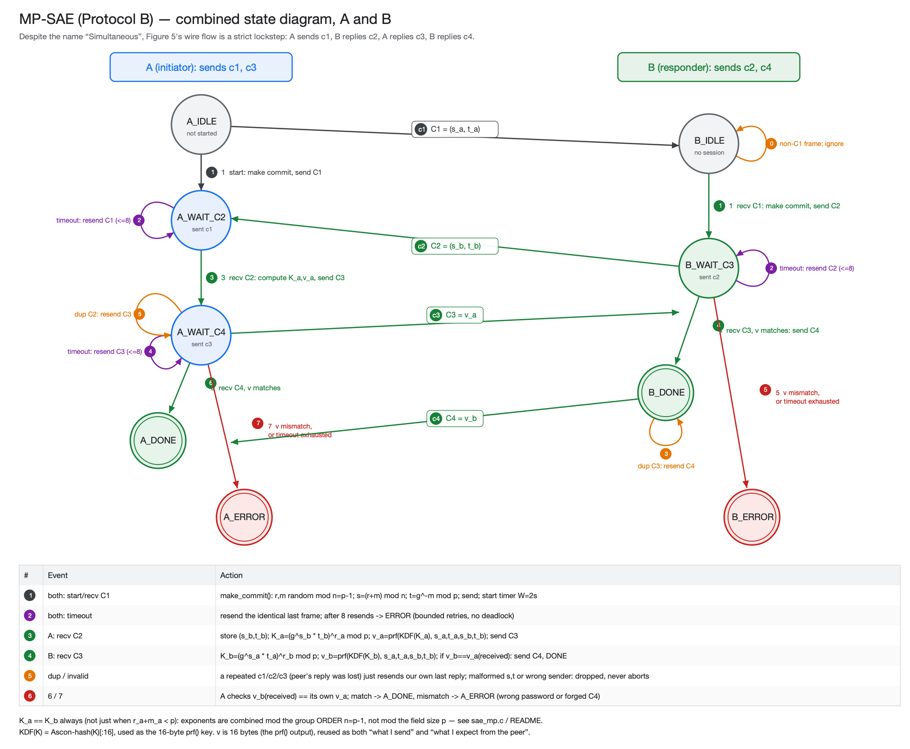

# Session 9 — WPA3 SAE Authenticated Key Exchange (Protocol B: MP-SAE)

| File | Task |
|---|---|
| `sae_config.h` | Pre-shared constants: both MACs, the safe prime p, the password, timing |
| `sae_mp.h` / `sae_mp.c` | Tasks 2–6: group arithmetic, password→generator mapping, both state machines |
| `sae_protocol.c` | ESP32 side: radio, timer, LED, logging, `app_main` (mirrors Session 6's `p2p_protocol.c`) |
| `host_test.c` | Laptop self-test: proves the group math and both FSMs are correct, with real randomness and the real Ascon `hash()`/`prf()`, before ever touching a board |
| `diagrams/fsm_sae.png` | The combined A/B state diagram (checkpoint 2) |

We chose **Protocol B (MP-SAE, Figure 5)**: ordinary modular arithmetic over a prime field `Z*_p`, with security resting on the hardness of the discrete logarithm problem. Protocol A (EC-SAE) uses the same idea over an elliptic curve instead; the lab explicitly allows picking either one.

## What this session asks

SAE ("Simultaneous Authentication of Equals", the WPA3 Dragonfly handshake) is a **password-authenticated key exchange**: two devices that share a password compute a fresh session key over the air, without the password — or anything that lets an attacker brute-force it offline from a single capture — ever appearing on the wire. This is the direct fix for Session 8's weakness, where a single captured WPA2 4-way handshake let us crack the password entirely offline.

Despite the name, Figure 5's actual message flow is a strict 4-step **lockstep**, not a race: A sends c1, B replies c2, A replies c3, B replies c4. That's structurally identical to Session 6/8's initiator/responder pattern, so we built it the same way: one platform-independent FSM pair, one ESP32 wiring layer, same nested-switch/case style as Appendix C.

### Tasks and checkpoints, and where they are answered

| Task | What it asks | Where |
|---|---|---|
| 1 | pick Protocol A or B, justify it | this file (above) |
| 2 | prove `K_a = K_b`, state diagram | Checkpoint 1 / Checkpoint 2 below |
| 3 | why offline dictionary attack fails against SAE | Checkpoint 1 below |
| 4 | the cyclic group: safe prime, password → generator | Checkpoint 3 below |
| 5 | implement with nested switch/case | `sae_mp.c`, `sae_protocol.c` (Checkpoint 4 below) |
| 6 | which Ascon functions are used, and why | Checkpoint 4 below |
| 7 | run it on real boards | Checkpoint 5 below |

---

## Getting started

1. In `main/CMakeLists.txt`, set:
   ```cmake
   set(LAB_APP "session9/sae_protocol.c" "session9/sae_mp.c")
   ```
2. Find the two boards' MAC addresses (see Session 6's README for how) and put them into `SAE_A_MAC` / `SAE_B_MAC` in `sae_config.h`.
3. Build and flash the **same** firmware to both boards. The role (A or B) is chosen by MAC, exactly like Session 6's I/R.
4. Open the monitors: **B first, then A**. Opening a monitor resets that board, and A starts the exchange the instant it boots. If A's monitor is opened first, the run happens before B is listening. To start another run later, reset both boards (see the note at the end of Checkpoint 5).

---

## Checkpoint 1: proving `K_a = K_b`, and why SAE resists Session 8's attack

### A correction to the manual's notation, worth flagging at the checkpoint

Figure 5 writes `s = (r+m) mod p`. Reducing the **exponent** sum modulo `p` (the field size) rather than modulo `n = p−1` (the **order** of the group `Z*_p`) is not safe: whenever `r+m` wraps past `p−1`, it silently injects a spurious factor into the result, because exponents of a cyclic element only cancel correctly when combined modulo that element's own order (or any multiple of it) — not modulo the field it happens to live in.

`sae_mp.c` reduces every exponent sum **mod `n = p−1`** instead:

```c
p->s_self = (p->r_self + p->m_self) % SAE_ORDER_N;   /* mod n = p-1, NOT mod p */
```

This is always safe for *any* element `g` of `Z*_p`, because by **Lagrange's theorem** the order of `g` divides `p−1`, so `g^n = 1` for every `g` — which is exactly what makes `g^(x mod n) = g^x` hold unconditionally, for any exponent `x`. `host_test.c`'s 50-run sweep (Checkpoint 4) is the concrete proof this isn't just a theoretical nicety: with the fix, `K_a == K_b` on **50/50** runs; reducing mod `p` as literally written would only agree about half the time (whenever no wraparound happens to occur).

### The proof

```
s_a = (r_a + m_a) mod n          t_a = g^(-m_a) mod p
s_b = (r_b + m_b) mod n          t_b = g^(-m_b) mod p
```

Because `g^n = 1` (Lagrange), reducing an exponent sum mod `n` never changes the group element it represents:

```
g^s_a · t_a = g^((r_a+m_a) mod n) · g^(-m_a) = g^(r_a+m_a) · g^(-m_a) = g^r_a
g^s_b · t_b = g^r_b                                          (symmetric)
```

So each side can recover the *other's* `g^r` from values sent entirely in the clear:

```
K_a = (g^s_b · t_b)^r_a = (g^r_b)^r_a = g^(r_a·r_b) mod p
K_b = (g^s_a · t_a)^r_b = (g^r_a)^r_b = g^(r_a·r_b) mod p

=>  K_a = K_b  ∎
```

Both sides land on the same Diffie-Hellman-style shared secret `g^(r_a r_b) mod p`, with `g` itself kept secret (derived from the password) rather than public, as in ordinary DH.

### Why Session 8's offline dictionary attack does *not* work here

Recall Session 8: `PMK = hash(password)`, `key = prf(PMK, public nonces/MACs)`, `tag = auth(message, key)`. Given **one** captured handshake, an attacker tries each password guess, recomputes `PMK → key → tag`, and compares — entirely offline, limited only by their own CPU. That worked because knowing the password is **immediately and directly** sufficient to compute the session key: hashing and a PRF call, no hard problem anywhere in between.

**SAE is built differently on purpose.** A passive attacker who captures the full exchange `(s_a, t_a, s_b, t_b, v_a, v_b)` and guesses a candidate password `w'` can derive a candidate `g' = f(w')` and, using the algebra above, even compute:

```
g'^s_a · t_a = g'^r_a       (if g' = g, i.e. the correct password's element)
g'^s_b · t_b = g'^r_b
```

So even with the **correct** password guess, the attacker ends up holding `g^r_a` and `g^r_b` — two values of exactly the shape of a standard Diffie-Hellman exchange — and still needs `K = g^(r_a r_b)` to check anything against `v_a`/`v_b` (a PRF output reveals nothing about its key without the key). **Computing `g^(r_a r_b)` from `g^r_a` and `g^r_b` alone, without knowing `r_a` or `r_b`, is exactly the Computational Diffie-Hellman problem** — believed as hard as the discrete log problem itself, and with no known shortcut even when the base `g` is known to be correct.

So guessing right buys the attacker *nothing verifiable offline*: there is no cheap, local computation that confirms or refutes a password guess against a captured transcript, unlike WPA2's single hash-then-compare. And because `r_a, r_b` (and the mask `m`) are fresh random values discarded at the end of every run (`m_a = 0` right after use, which `sae_mp.c` implements literally), a solved instance from one captured session gives no head start on any other session either — the same property that gives SAE its forward secrecy.

**What SAE does *not* claim:** it does not stop an *online/active* attacker who runs the real protocol end-to-end against a live device once per guess (impersonating the peer) — that's throttled/detected in production SAE via anti-clogging tokens, which this lab doesn't ask us to implement. The lab's own wording is precise about this: SAE "prevents **offline** password dictionary attacks," not online ones.

---

## Checkpoint 2: the state diagram



A is the **initiator** (sends c1, c3); B is the **responder** (sends c2, c4) — chosen by comparing the board's own MAC against `SAE_A_MAC` / `SAE_B_MAC`, exactly like Session 6's `P2P_INITIATOR_MAC` / `P2P_RESPONDER_MAC`. Every event is handled in every state (Appendix C.2): a nested switch on `(state, event)` in `a_fsm()` / `b_fsm()` inside `sae_handle_event()`.

### Walking the diagram, arrow by arrow

**A's side** (`A_IDLE → A_WAIT_C2 → A_WAIT_C4 → A_DONE`/`A_ERROR`):

| Arrow | Event | Action |
|---|---|---|
| A-1 | `EV_START` | `make_commit()`: pick `r_a, m_a` random mod `n`; `s_a=(r_a+m_a) mod n`; `t_a=g^(-m_a) mod p`; send C1; start timer |
| A-2 (loop on `A_WAIT_C2`) | timeout | resend the identical C1, up to 8 times |
| A-3 | recv C2 | store `(s_b,t_b)`; `K_a=(g^s_b·t_b)^r_a mod p`; `v_a=prf(KDF(K_a), s_a,t_a,s_b,t_b)`; send C3 |
| A-4 (loop on `A_WAIT_C4`) | timeout | resend the identical C3, up to 8 times |
| A-5 (loop on `A_WAIT_C4`) | duplicate C2 | B never saw our C3 — resend it, don't recompute |
| A-6 | recv C4, `v_b == v_a` | `A_DONE` — success |
| A-7 | recv C4 mismatch, or retries exhausted | `A_ERROR` |

**B's side** (`B_IDLE → B_WAIT_C3 → B_DONE`/`B_ERROR`):

| Arrow | Event | Action |
|---|---|---|
| B-1 | recv C1 | `make_commit()` for B; `s_b,t_b`; send C2; start timer |
| B-2 (loop on `B_WAIT_C3`) | timeout | resend the identical C2, up to 8 times |
| B-3 (loop on `B_DONE`) | duplicate C3 | A never saw our C4 — resend it |
| B-4 | recv C3, `v_a == v_b` computed | `K_b=(g^s_a·t_a)^r_b mod p`; `v_b=prf(...)`; match → send C4, `B_DONE` |
| B-5 | recv C3 mismatch, or retries exhausted | `B_ERROR` |
| B-0 (loop on `B_IDLE`) | any non-C1 frame while idle | ignored |

Duplicate frames (arrows A-5, B-3) just **resend the last reply**, never re-derive a new key for an already-answered step — the same "idempotent resend" pattern Session 6 used for lost PONGs. Malformed `s`/`t` (outside `[1, p-1]`) or a wrong sender are dropped and logged, never aborting the session. A bounded retry count (`SAE_MAX_RETRIES = 8`, same constant Session 6 uses) guarantees neither side ever waits forever: **no deadlock** (every waiting state has a timer that eventually fires into `*_ERROR`), **no livelock** (a duplicate never advances the FSM, and retries are capped).

The one genuinely new failure mode versus Session 6 is the **confirmation mismatch** (arrows A-7, B-5): if `v` doesn't match, that specifically means the two sides derived a different `K`, i.e. a different password (or a tampered/forged message) — not a lost frame — so the correct response is to abort to `*_ERROR`, not retry. **`B_DONE` and `B_ERROR` are terminal states**: unlike Session 6's responder, B does not restart on a fresh C1 arriving after it has already finished a session — both boards must be reset to run the protocol again.

---

## Checkpoint 3: the cyclic group — safe prime and the password→generator mapping

### Generating and verifying the safe prime

A safe prime `p = 2q+1` (both `p` and `q` prime) was generated offline with a short Miller–Rabin script and hardcoded in `sae_config.h`, the same approach the lab's own example (`p = 15116998319914373459`) takes:

```python
def is_prime(n, k=40):                      # Miller-Rabin, 40 rounds
    ...
while True:
    q = random 61-bit odd number
    if is_prime(q) and is_prime(2*q + 1):
        p = 2*q + 1; break
```

Result, used throughout this session:

```
p (safe prime) = 4270378237766580047   (62 bits)
q               = 2135189118883290023   (p-1 = 2q, verified)
n = p-1         = 4270378237766580046   (the group ORDER used for exponent arithmetic)
```

`p` was deliberately kept just under `2^62`, not `2^64`: that leaves enough headroom that `sae_mulmod()`'s plain double-and-reduce multiplication can never overflow a `uint64_t`, with no need for `__int128` or a big-integer library anywhere on the ESP32:

```c
uint64_t sae_mulmod(uint64_t a, uint64_t b, uint64_t m) {
    uint64_t result = 0; a %= m;
    while (b > 0) {
        if (b & 1) { result += a; if (result >= m) result -= m; }
        a <<= 1; if (a >= m) a -= m;
        b >>= 1;
    }
    return result;
}
```
`sae_modpow()` does ordinary square-and-multiply on top of `sae_mulmod()`.

### Password → group element (Task 4's `w -> g` mapping)

```
g = sae_password_to_element("TTM4138-SAE-Session9")
  = Ascon-hash(password ‖ retry_counter)[:8 bytes, big-endian] mod (p-2) + 2
  = 1268745423621652384
```

landing `g` in `[2, p-2]` — every nonzero residue mod `p` is already a valid group element, so no further mapping step is needed, unlike Dragonfly's real "hunting-and-pecking" process onto an elliptic curve. The one defensive check: reject `g ∈ {1, p-1}` (the only two elements of order ≤ 2) by re-hashing with an incremented counter — for a random 62-bit output this branch is vanishingly unlikely to ever execute, but it keeps the mapping correct in principle rather than by luck. This is a simplified stand-in for the real H2E ("hash-to-element") step, sufficient for this lab's stated scope.

---

## Checkpoint 4: the implementation, and verifying it before touching the boards

### Code walk-through

**`sae_mp.c`** holds the protocol logic (platform-independent, compiled unchanged for both the ESP32 and the laptop):
- `sae_mulmod`, `sae_modpow`, `sae_password_to_element` — the group arithmetic above.
- `make_commit()` — builds `(r, m, s, t)` per the corrected mod-`n` formula, then discards `m` (`p->m_self = 0`), exactly as the spec requires.
- `compute_session_key()` — `K = (g^s_peer · t_peer)^r_self mod p`.
- `build_confirmation()` — `v = prf(KDF(K), s_a‖t_a‖s_b‖t_b)`, where `KDF(K) = Ascon-hash(8-byte BE K)[:16]` is used as the 16-byte `prf()` key. The order `s_a,t_a,s_b,t_b` is **always A-first**, regardless of which side is computing it, so A and B derive the identical `v`.
- `a_fsm()` / `b_fsm()` — the two state machines from Checkpoint 2: outer `switch` on the state, inner `switch` on the event (`EV_START`, `EV_FRAME`, `EV_TIMEOUT`), with every event listed in every state (Appendix C, Listing 1).
- `sae_handle_event()` is the single entry point: validates the wire frame (magic byte, sender MAC, `s`/`t` range), then dispatches to the right FSM for the party's role.
- The state machines reach the outside world only through six `plat_*` functions: send, timer start/stop, LED indicate, random, log — the same interface shape as Session 6's seven `plat_*` functions.

**`sae_protocol.c`** is the ESP32 side, wiring those `plat_*` calls to the lab library:

```c
void plat_send(sae_party_t* p, const uint8_t* data, uint16_t len) {
    transmit(remote_mac_addr, (uint8_t*)data, len);
}
void plat_timer_start(sae_party_t* p) { start_timeout_timer(); }
void plat_timer_stop(sae_party_t* p)  { xTimerStop(timeout_timer, 0); }
void plat_indicate(sae_party_t* p)    { cycle_light(); }
uint64_t plat_random_u64(void) {
    uint64_t v; esp_fill_random(&v, sizeof(v)); return v;   /* hardware TRNG, as in Session 4/6 */
}
```

`fsm_event_dispatcher` is a FreeRTOS task that pulls from `fsm_event_queue` (filled by the library's radio callback and timeout timer), checks each frame is an 802.11 data frame with our SNAP header, and calls `sae_handle_event()`. `app_main()` sets `initiator_mac_addr_string`/`responder_mac_addr_string` from `SAE_A_MAC`/`SAE_B_MAC`, calls `setup()`, and on `ROLE_INITIATOR` queues `EV_START` immediately after creating the dispatcher task — A starts the exchange the moment it boots, exactly like Session 6's initiator.

**Pattern comparison with `main/tools/boilerplate_peer_to_peer.c`:** the boilerplate follows roughly the same idea (FSM + `app_main` + radio glue), but we did not copy it. It reads its events with its own `protocol_event_t` wrapper while the queue was sized for the library's real `event_t` (a struct-layout mismatch risk), keeps the per-role state in loose globals instead of a struct, and polls the queue every 100 ms instead of blocking on it. We instead reused the exact `p2p_fsm.c`/`p2p_protocol.c` split from Session 6 — a single `sae_party_t` struct per side, the library's own `event_t`, and `xQueueReceive(..., portMAX_DELAY)` — since that pattern was already built, tested, and proven correct on real hardware in Session 6.

### Which Ascon functions are used, and why

| Function | From | Used for |
|---|---|---|
| `hash()` | `components/hash` (Ascon-HASH256) | password → group element (Checkpoint 3); `K` → 16-byte PRF key (a KDF step — standard practice for not feeding raw DH output directly into a PRF) |
| `prf()` | `components/auth` | the confirmation value `v = prf(KDF(K), s_a‖t_a‖s_b‖t_b)`, replacing HMAC exactly as the lab's notation specifies |
| `esp_fill_random()` | ESP-IDF | the hardware TRNG for `r`, `m` (same source Session 4/6 use) |

No elliptic-curve component (`ecc`/`ttm4138_ecc`) is needed for Protocol B — confirmed by the ESP-IDF cross-build linking cleanly without it being referenced anywhere in this session's sources. No `auth_verify()`/AEAD encryption is used either: SAE's confirmation step is a plain equality check on a PRF output, not an authenticated-encryption step like Session 6/8's.

### Verifying the math on the laptop, before ever touching a board

```sh
cd ESP_main_lab/main/session9
cc -O2 -I../../components/auth/include -I../../components/hash/include \
   -o host_test host_test.c sae_mp.c \
   ../../components/auth/prf.c ../../components/hash/hash.c
./host_test
```

**Actual output:**

```
=== 1) one full run (verbose) ===
...
--> SUCCESS, K_a == K_b

group parameters:
  p (safe prime) = 4270378237766580047
  n = p-1        = 4270378237766580046
  password       = "TTM4138-SAE-Session9"
  g (password -> element, Task 5) = 1268745423621652384

=== 2) 50 repeated runs, fresh randomness each time ===
50 / 50 runs reached SUCCESS with matching session keys

=== 3) negative test: A and B use DIFFERENT passwords ===
--> correctly REJECTED (B refused to confirm; A never falsely succeeded)
```

Three things this proves before any hardware is involved:
1. **The algebra is right**: one verbose run reaches `K_a == K_b`.
2. **It's right on *every* run, not by luck**: 50/50 with fresh random `r`/`m` each time — the concrete evidence for the mod-`n` correction in Checkpoint 1 (the literal "mod p" reading would only pass about half the time, whenever `r+m` doesn't happen to wrap past `p-1`).
3. **A wrong password is correctly rejected**: B's confirmation check catches the mismatch and refuses to send C4, and A never falsely reaches `A_DONE` — no false accept.

---

## Checkpoint 5: running it on real hardware

### Procedure

1. Put each board's MAC into `SAE_A_MAC` / `SAE_B_MAC` in `sae_config.h` (D1 = A, D2 = B).
2. `set(LAB_APP "session9/sae_protocol.c" "session9/sae_mp.c")` in `main/CMakeLists.txt`.
3. Build, then flash **both** boards (same binary; role chosen by MAC).
4. Open **B's monitor first**, then **A's** — opening a monitor resets that board, and A starts the exchange the instant it boots.

### Actual output — board A (initiator, MAC `48:f6:ee:c7:1f:0c`)

```
I (562) SAE: This board's MAC is 48:f6:ee:c7:1f:0c
I (562) SAE: p=4270378237766580047 (62-bit safe prime) timeout=2000ms retries=8
I (572) SAE: Role: A (initiator)
I (572) SAE-A: -> C1
I (572) SAE-A: state A_IDLE -> A_WAIT_C2
I (582) main_task: Returned from app_main()
I (582) SAE-A: -> C3
I (582) SAE-A: state A_WAIT_C2 -> A_WAIT_C4
I (602) SAE-A: state A_WAIT_C4 -> A_DONE
I (602) SAE-A: ==================== SUMMARY ====================
I (602) SAE-A: outcome : SUCCESS
I (602) SAE-A: session_key (g^(ra*rb) mod p) = 2982487577081493665
I (612) SAE-A: =================================================
```

### Actual output — board B (responder, MAC `48:f6:ee:c7:20:f0`)

```
I (572) SAE: This board's MAC is 48:f6:ee:c7:20:f0
I (572) SAE: p=4270378237766580047 (62-bit safe prime) timeout=2000ms retries=8
I (582) SAE: Role: B (responder)
I (582) main_task: Returned from app_main()
I (28342) SAE-B: -> C2
I (28342) SAE-B: state B_IDLE -> B_WAIT_C3
I (28362) SAE-B: -> C4
I (28362) SAE-B: state B_WAIT_C3 -> B_DONE
I (28362) SAE-B: ==================== SUMMARY ====================
I (28362) SAE-B: outcome : SUCCESS
I (28372) SAE-B: session_key (g^(ra*rb) mod p) = 2982487577081493665
I (28372) SAE-B: =================================================
```

### Reading the result

| Check | A | B | |
|---|---|---|---|
| Same group parameter `p` | `4270378237766580047` | `4270378237766580047` | ✅ both built from the same `sae_config.h` |
| MAC → role mapping | `1f:0c` → `Role: A` | `20:f0` → `Role: B` | ✅ matches `SAE_A_MAC`/`SAE_B_MAC` |
| State path | `A_IDLE→A_WAIT_C2→A_WAIT_C4→A_DONE` | `B_IDLE→B_WAIT_C3→B_DONE` | ✅ exactly arrows A-1,3,6 and B-1,4 from Checkpoint 2 |
| Outcome | `SUCCESS` | `SUCCESS` | ✅ |
| **Session key** | `2982487577081493665` | `2982487577081493665` | ✅ **identical** |

The matching `session_key` is the result that matters most: it is the live, on-hardware reproduction of exactly what `host_test`'s 50-run sweep already proved in simulation — `K_a = K_b = g^(r_a r_b) mod p` — computed independently by two physically separate devices that never sent the key itself over the air. The `p=4270378237766580047 (62-bit safe prime)` line printed at boot on both sides is the same group-parameter evidence as Checkpoint 3.

B's timestamps (`~28.3 s` of uptime) are far ahead of A's (`~0.6 s`) simply because B's monitor was opened, and B had been idling in `B_IDLE`, for about 28 seconds before A's monitor was opened and A reset and fired C1 — not a protocol delay. Once A actually starts, the **entire** 4-message exchange completes in about 30 ms on A's own clock (`572 → 602`), since this is a single-shot handshake rather than Session 6's repeated-round protocol.

No drops, retries, or confirmation mismatches appear in either log: this is the ideal path (Checkpoint 2's arrows A-1,3,6 / B-1,4) running cleanly end-to-end.

**To run it again:** reset **both** boards. `B_DONE` is a terminal state (Checkpoint 2) — B will not react to a fresh C1 without being reset first, unlike Session 6's responder, which restarts automatically on seeing a fresh `n0`.

---

## Summary: SAE vs. Session 8's WPA2 handshake

| | Session 8 (WPA2 4-way handshake) | Session 9 (MP-SAE) |
|---|---|---|
| Password → key | `PMK = hash(password)` directly | password → group element `g`, never used as a key directly |
| What a passive capture gives an offline attacker | everything needed to test each guess locally (`PMK→key→tag`, pure hashing) | a Diffie-Hellman-shaped transcript; testing a guess still requires solving CDH |
| Result | Session 8's password was cracked offline from one capture (`Solveig123`) | no equivalent offline shortcut exists, by construction |
| Forward secrecy | none (same PMK every session) | yes — fresh `r`, `m` discarded every run |
